# Hi, I'm Bernard 👋

**Software Engineer · Full-Stack Developer · Fintech & Systems Builder**

I build production-ready systems across web, desktop, and mobile: React and Electron apps with hardware licensing, and Node.js backends on Linux VPS with Docker, Nginx, and automated database pipelines.

Currently a National Service Personnel at the **Ghana Cooperative Credit Unions Association (CUA)**, deploying and maintaining core banking infrastructure for credit unions across Ghana.

---

## ⚡ At a Glance

| Highlight | Scope |
|---|---|
| **3 platforms** | web, desktop (Electron), and mobile (React Native) shipped to production |
| **0 → prod** | end-to-end ownership: code, database, VPS, SSL, DNS, backups |

---

## 🛠 Tech Stack

| Area | Tools |
|---|---|
| **Languages** |      |
| **Frontend** |      |
| **Backend & Data** |       |
| **Infrastructure** |      |

---

## 🚀 Selected Projects

🔒 = private or proprietary (no public repo)

### Desktop
| Project | Description | Stack |
|---|---|---|
| [orient Fees Tracker](https://github.com/GrandmaSylar/orient) | School fees tracking app with hardware-bound licensing, MSSQL integration, and auto-update delivery | Electron 43, React 19, TypeScript, MSSQL |
| [Invitro LIMS](https://invitro-iota.vercel.app) | Laboratory Information Management System: test tracking, appointments, and results processing | Electron 42, React 18, TypeScript, SQLite, Supabase |
| easyMigrate 🔒 | ETL migration utility that cleans and deduplicates financial records, shipped as a standalone `.exe` | React, Node.js, Express, T-SQL |

### Web
| Project | Description | Stack |
|---|---|---|
| [Concord](https://concord-dun.vercel.app) | Bulk SMS platform: contact management, campaign scheduling, delivery analytics | Next.js 16, React 19, Supabase, Tailwind CSS |
| [PhiNova](https://phinova.dev) | Company website with headless CMS, email notifications, and dynamic content | Next.js 16, Sanity CMS, Resend, Tailwind CSS |
| [Tilly's Gallery](https://www.tillygallery.shop) | Online boutique storefront for an Accra fashion and beauty shop: product browsing and filters, wishlist, cart, and WhatsApp checkout | Next.js 15, React 19, TypeScript, Tailwind CSS, Neon Postgres, Cloudinary |
| [escobar](https://prezz.vercel.app) | Live web app with a design system and UI component library | React 18, TypeScript, Tailwind CSS, Radix UI |

### Mobile
| Project | Description | Stack |
|---|---|---|
| ManduuApp 🔒 | Campus commerce app (iOS/Android) connecting students with shops, vendors, and service providers | React Native, Expo, TypeScript |

### Management Systems
| Project | Description | Stack |
|---|---|---|
| Church Management System 🔒 | Church operations platform: members, attendance, tithes, role-based access, 20+ API endpoints | React 18, Node.js, Express, MongoDB, JWT |
| PCAcademy 🔒 | Academy management: student registration, admin dashboard, drag-and-drop form builder, CSV export | React 18, TypeScript, Supabase, Hono |

---

## 🏦 Current Work: CUA National Service (2025–2026)

**Infrastructure & deployment**
- Deployed and configured QSS Core Banking backends on Linux VPS servers with Nginx, SSL, PM2, Docker, and DNS
- Designed an automated daily backup system using bash, cron, and Docker container integration

**Data & reliability**
- Led recovery of a production MSSQL database, tracing its backup files through Docker's overlay filesystem
- Built **easyMigrate**, a Node.js ETL tool that cleans and migrates credit union financial records with verified reconciliation against source records
- Reconciled mobile banker transactions against member records and delivered structured audit reports

**People**
- Trained client institution staff on QSS Core Banking software

---

## 📊 GitHub Stats

  <picture>
    <source media="(prefers-color-scheme: dark)" srcset="./profile/stats-dark.svg">
    
  </picture>
  <picture>
    <source media="(prefers-color-scheme: dark)" srcset="./profile/top-langs-dark.svg">
    
  </picture>

---

*Building things that work in the real world.*
